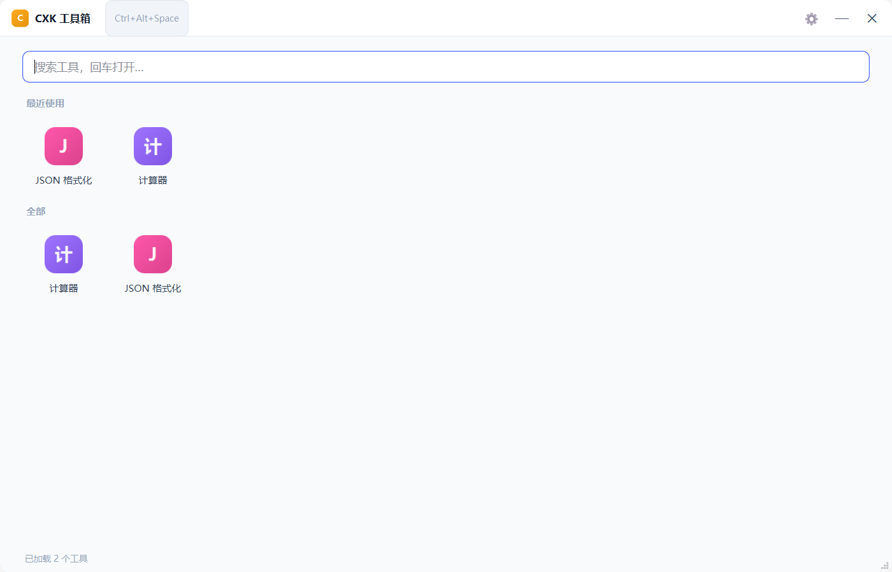

# CXK 工具箱

一个**完全离线**的桌面小工具集合：没有插件市场、没有在线安装、不联网。
所有工具都是本地代码（插件动态库），启动时扫描 `plugins/` 加载，丢进去就装、删掉就卸。

一个窗口装下所有常用小工具：唤出就是一张图标网格，点图标进工具、输入关键词直接搜；
想边干活边切工具，可以把某个工具单独开成窗口。



## 支持平台

| 平台 | 状态 | 说明 |
| --- | --- | --- |
| Windows 10 / 11 | 完整支持 | 全局热键、开机自启、托盘全部可用 |
| macOS 12+ | 支持 | 界面、插件、托盘可用；**全局热键与开机自启尚未实现**，使用时会给明确提示 |
| Linux（X11） | 可构建 | 全局热键走 X11 `XGrabKey`；Wayland 会话下没有全局热键 |

启动、按热键、点托盘「呼出搜索」都会回到**首页网格**：点图标进工具，或直接输入关键词过滤，
回车打开第一个结果。在工具页里按 `Esc`（或点页头「← 首页」）退回网格，在网格里按 `Esc` 收进托盘
（不退出）。搜索框里 `Esc` 是先清关键词，清空后再按才收起窗口。
`Ctrl+Alt+Space` 可从任意位置呼出（平台支持情况见上表）。

想同时看两个工具，点工具页头右侧的「独立窗口」，或在网格上右键图标选「在独立窗口打开」。

## 现在支持的工具

| 工具 | 能力 |
| --- | --- |
| JSON 格式化 | 格式化 / 压缩 / 转义 / 反转义；解析失败给出精确的行列位置 |
| 计算器 | 递归下降求值，支持 `+ - * / % ^ ()` 与 `pi`/`e`，边输边算，回车存历史 |

工具本身是插件：新增工具不需要改主程序，见[增加新插件](#增加新插件)。

## 环境要求

| 依赖 | Windows | macOS | Linux |
| --- | --- | --- | --- |
| Qt | 6.8.3 `msvc2022_64`（6.5+ 亦可） | 6.8+ `clang_64`（官方安装包） | 发行版包 `qt6-base-dev` |
| 编译器 | MSVC 19.4x+（VS 2022 及以上） | Xcode Command Line Tools | GCC 9+ / Clang 10+ |
| 构建工具 | CMake ≥ 3.21 + Ninja | 同左 | 同左（另需 `libx11-dev`、`libxcb1-dev`） |

## 构建

Windows（脚本顶部写死了本机 Qt / VS / CMake / Ninja 路径，换机器改这几行即可）：

```bat
scripts\build.bat            :: Release
scripts\build.bat Debug
```

macOS / Linux（自动使用 ninja；需要指定 Qt 时设 `QT_DIR`）：

```sh
scripts/build.sh             # Release
scripts/build.sh Debug
# 等价于
cmake -S . -B build -G Ninja -DCMAKE_BUILD_TYPE=Release -DCMAKE_PREFIX_PATH=<Qt 路径>
cmake --build build
```

**产物**（三平台目录结构一致）：

```
build/bin/cxk-tools                 主程序（Windows 为 cxk-tools.exe）
build/bin/plugins/calc              插件动态库（.dll / .dylib / .so）
build/bin/plugins/jsonfmt
```

开发期直接运行 `build/bin/cxk-tools`。Windows 构建时会自动把 Qt 运行时部署到 `bin/`
（`cmake/DeployQt.cmake`，只跑一次），所以双击或在 IDE 里点运行都不会缺 DLL；若看到缺 DLL
的提示，多半是部署失败，把 `C:\Qt\6.8.3\msvc2022_64\bin` 加进 `PATH` 即可。

### 在 IDE 里开发（CLion）

仓库根目录带 `CMakePresets.json`，CLion 会自动提示切换到 presets；也可以手动在
`Settings → Build, Execution, Deployment → CMake` 里选 `debug` / `release` 配置，
再把 Toolchain 设为 Visual Studio（不要用 MinGW，Qt 是 MSVC 版）。

命令行等价：

```bat
cmake --preset debug
cmake --build --preset debug
```

产物在 `build/clion-debug/bin/`，与 `scripts\build.bat` 用的 `build/bin/` 互不干扰。
presets 里的 `CMAKE_PREFIX_PATH` 是本机 Qt 路径，换机器或换平台时改这一行（macOS/Linux 直接用 `scripts/build.sh`）。

在 IDE 里点「运行」时只会构建运行配置选中的目标，`cxk-tools` 已在根 `CMakeLists.txt` 里
显式依赖全部插件目标，插件会自动连带构建到 `bin/plugins/`，不需要手动 Build All。
应用**只在启动时扫描插件目录**，构建出插件后重启应用才会加载。

如果侧边栏文件全是灰的、或编辑器顶部提示「此文件不属于任何项目目标」，说明 CLion 没把
`CMakeLists.txt` 当成 CMake 工程（工程在仓库还空着时被打开过一次，模型缓存会一直沿用这个判断）。
按顺序处理：`文件 → 使缓存失效 → 清除并重新加载`，或直接关掉 IDE、删除 `.idea/` 与
`%LOCALAPPDATA%\JetBrains\CLion*\projects\<工程名>.*\` 后再打开。另外**不要从终端里 `start clion64.exe`**
启动 IDE —— 它会把启动终端的限制一起继承（例如受限账号下 `vcvarsall` 调不动 `reg.exe`，
表现为「读不到 MSVC 环境 → cmake 找不到编译器 → 配置静默失败」）。

## 打包成可分发目录

Windows：

```bat
scripts\package.bat
```

得到 `dist\`：可执行文件 + windeployqt 拉齐的 Qt 运行时 + `plugins\`，整个目录拷走就能跑。

macOS 用 `macdeployqt` 拉齐运行库后打成 `.app`；Linux 把可执行文件与 `plugins/` 放同一目录，
必要时用 `linuxdeploy` / `appimagetool` 打包，Qt 运行库按发行版方式分发。

## 增加新插件

一个工具 = 一个 `QWidget` 面板 + 一份元信息，三步：

1. `plugins/mytool/` 下写一个类，继承 `QObject` 与 `xtools::ITool`，
   必须带 `Q_OBJECT`、`Q_PLUGIN_METADATA(IID XTOOLS_ITOOL_IID)`、`Q_INTERFACES(xtools::ITool)`；
2. `plugins/mytool/CMakeLists.txt` 写 `xtools_add_plugin(mytool SOURCES MyTool.cpp MyTool.h)`；
3. 根 `CMakeLists.txt` 末尾加 `add_subdirectory(plugins/mytool)`，重新构建。

产物落到 `build/bin/plugins/`，重启应用即可在首页网格里看到。

几条关键约定：`createPanel()` 每次返回**全新**的面板且不要设 parent（宿主接管）；
cpp 里还有 `Q_OBJECT` 内部类时，文件末尾要 `#include "MyTool.moc"`；
改 `ITool.h` 必须升 `XTOOLS_API_VERSION`（宿主拒绝加载版本不符的插件而不是崩溃）。

完整模板、注意事项与调试方法见 [docs/PLUGIN.md](docs/PLUGIN.md)。

## 界面与能力

- **首页网格**：图标磁贴两排分组——「最近使用」（最多 8 个，没有记录时整组不显示）与「全部」；
  列数随窗口宽度自适应。点图标进工具，`←→↑↓` 移动选中、回车打开
- **搜索**：首页顶部输入关键词即过滤，相关度排序后塌成一组「搜索结果」，回车打开第一个；
  支持子串、关键词与首字母缩写（如 `jf` → JSON 格式化）；框内 `✕` 或 `Esc` 清空
- **工具页**：页头有「← 首页」与「独立窗口」；面板不缓存，离开工具视图即销毁，
  每次进入都是全新面板（输入值不留存）
- **独立窗口**：每个工具最多一个，重复打开只把已有窗口前置；主窗口收起时它继续存在，
  退出程序时统一关闭。窗口位置/大小会被记住
- **全局热键**：默认 `Ctrl+Alt+Space`，失败会区分「被其他程序占用」与「组合键不合法」
- **托盘常驻**：呼出搜索 / 打开主窗口 / 设置 / 重新扫描插件（重启）/ 退出
- **单实例**：重复启动只把已有实例的主窗口唤起来
- **设置持久化**：INI 配置，热键、开机自启、最近使用、窗口位置与大小、使用频次

## 命令行参数

| 参数 | 作用 |
| --- | --- |
| `--autostart` | 开机自启时使用：只驻留托盘，不打开任何窗口 |
| `--settings` | 启动后直接打开设置页 |
| `--tool <id>` | 启动后直接在主窗口里打开该工具（如 `--tool jsonfmt`） |
| `--popout <id>` | 启动后直接以独立窗口打开该工具（如 `--popout calc`） |
| `--shot <路径>` | 调试用：把窗口渲染成 PNG 后退出（可配 `--settings` / `--tool` / `--popout` 截不同页面） |

## 目录结构

```
src/
  api/ITool.h        插件接口（宿主与插件共享的唯一头文件）
  core/              配置、日志、单实例、热键、工具注册表、插件加载、组装
  ui/                主窗口、首页网格、独立工具窗口、设置页、托盘
  app/main.cpp       入口 + 样式表资源
plugins/
  jsonfmt/           JSON 格式化
  calc/              计算器
cmake/               xtools_add_plugin() 等构建辅助
scripts/             build.bat / build.sh / package.bat
docs/PLUGIN.md       插件开发详解
```

## 运行时数据

| 内容 | 位置 |
| --- | --- |
| 配置 | `QStandardPaths::AppConfigLocation` 下的 `cxk-tools.ini`（Windows `%LOCALAPPDATA%\cxk\cxk-tools\`；macOS `~/Library/Application Support/cxk/cxk-tools/`；Linux `~/.config/cxk/cxk-tools/`）。除热键/自启外还保存最近使用的工具、主窗口与各独立窗口的位置大小 |
| 日志 | `QStandardPaths::AppLocalDataLocation` 下的 `logs/app.log` |
| 插件 | 与可执行文件同级的 `plugins/`（macOS 在 `.app/Contents/MacOS/plugins`） |
| 开机自启 | Windows：`HKCU\...\Run`；Linux：`~/.config/autostart/cxk-tools.desktop`；macOS：未实现 |

## 平台差异

| 能力 | Windows | macOS | Linux |
| --- | --- | --- | --- |
| 界面 / 插件 / 托盘 | 支持 | 支持 | 支持（托盘依赖 StatusNotifier / AppIndicator） |
| 全局热键 | `RegisterHotKey` | 未实现（提示"暂未实现"） | X11 `XGrabKey`；Wayland 下提示原因 |
| 开机自启 | 注册表 Run 项 | 未实现（日志警告） | XDG autostart `.desktop` |

## 已知边界

- 插件不支持运行时热卸载：重新扫描走「重启应用」，避免已创建的面板指向已卸载的代码段
- 搜索匹配是子串 + 首字母缩写，没有做拼音
- 每个工具最多一个独立窗口；同一工具可以同时存在「主窗口内嵌」与「独立窗口」两份面板，
  两者的输入互不影响（插件不该假设自己是唯一实例）
- 唤出会回到首页并销毁内嵌面板，正在输入的内容不保留——要留着就用独立窗口
- 「最近使用」只记最近 8 个，启动与唤出不算「使用」，只有主动打开工具才计入
- macOS 的全局热键（Carbon / 辅助功能 API）与 LaunchAgent 自启尚未实现
- Wayland 会话下没有全局热键，需要快捷键时请用 X11 会话登录

## 后续可以加什么

- 搜索框里直接出结果（输入 `12*8` 就地显示 `96`），不用打开面板
- 剪贴板历史、取色器、文件快速搜索
- 深色主题跟随系统
- 快捷键直达某个工具 / 收藏（固定到网格顶部）
- macOS 全局热键与开机自启
